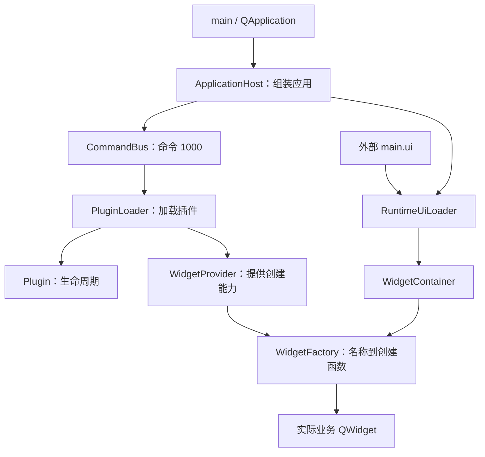

# 01 软件全貌与设计思路

[返回目录](README.md) · [下一章：基础概念](02-basics.md)

## 1. 先用一句话认识这个软件

LearnFramework 是一个使用 Qt Widgets 和 C++11 编写的插件框架学习项目：主程序搭建窗口和通用服务，各个 DLL 提供可装入窗口的内容与业务逻辑，外部 UI 文件决定这些内容摆在哪里。

“框架”可以理解为一套预先安排好的协作规则。你按规则实现插件，主程序就能在合适的时候调用它。与单个计数器程序相比，这个项目更关注“以后再加一组界面时，已有主程序怎样少改代码”。

## 2. 运行后有哪些东西

默认主窗口有两行三列：

| 位置 | 内容 | 创建来源 |
| --- | --- | --- |
| 左上 | 计数、发送设备连接/断开命令、显示设备消息 | ContentPlugin 的 FWidget |
| 左下 | 文本输入和回显、另一份设备消息显示 | ContentPlugin 的 GWidget |
| 中上 | 模拟设备名称、连接状态、刷新间隔 | DevicePlugin 的 DeviceMonitorWidget |
| 中下 | 编辑设备名称和刷新间隔 | DevicePlugin 的 DeviceSettingsWidget |
| 右上 | 只读报表预览 | ReportPlugin 的 ReportViewerWidget |
| 右下 | 编辑报表并提交预览 | ReportPlugin 的 ReportEditorWidget |

如果插件目录包含 DemoPlugin，还会出现独立的计数工具窗口。它没有嵌入上述六个区域，是演示最小插件生命周期的另一种例子。

设备连接只修改内存中的布尔值，刷新间隔只是可编辑配置。报表是文本编辑与预览，不是报表导出系统。重启后这些业务数据恢复初始值。

## 3. 为什么不直接把所有界面写在 main 中

直接写在一起也能实现六个面板，但每增加一种业务界面，都可能需要改主程序、重新编译主程序，并让主程序认识越来越多业务类。

当前设计把变化拆成三个问题：

1. **界面放在哪里？** 交给外部 `ui/main.ui`。
2. **某个区域显示哪种内容？** 交给 `contentClass` 配置和窗口工厂。
3. **这种内容如何实现？** 交给内置 QWidget 子类或插件 DLL。

因此，改变布局通常只需要改 UI 并重启；增加插件内容通常需要编译新 DLL、部署并更新 UI；修改公共接口或主程序能力仍然需要重建相关组件。插件化没有消灭编译，只是缩小了修改影响范围。

## 4. 源码的四个主要区域

| 区域 | 职责 | 最适合从哪里读 |
| --- | --- | --- |
| `src/foundation` | 公共接口、协议、底层总线和注册表 | Plugin.h、PluginServices.h |
| `src/runtime` | 启动、插件扫描、通信接口实现 | main.cpp、ApplicationHost.cpp |
| `src/widgets` | 通用容器、工厂、运行时 UI 加载、内置演示控件 | WidgetFactory.cpp |
| `examples` | 四个真实插件的实现 | DemoPlugin，再到 ContentPlugin |
| `tests` | Qt 测试程序 | ApplicationHostUiTests.cpp |
| `ui` | 随构建部署的 UI 源文件 | main.ui |

foundation 并不完全等于“纯通用”：例如 DeviceProtocol.h 已经包含设备演示的命令约定。这是学习项目的实际组织方式。

`build` 保存中间产物，`bin` 保存可运行程序、插件和部署后的 UI。阅读实现时优先看源码目录，旧构建产物不一定对应当前源码。

## 5. 架构图

图里有两种“调用时机”：加载插件时登记创建函数；加载 UI 后才按名称执行这些函数。工厂不会在登记时预先创建全部窗口。

## 6. 用一个扩展需求理解设计

假设要加“温度面板”：

- 如果只想快速学习，可以把 TemperatureWidget 编译进主程序，并登记为 `temperature`。
- 如果要保持主程序不变，可以在兼容的插件里提供 `sensor.temperature`。
- 两种方式最终都由容器调用同一个工厂入口创建。
- UI 无须了解温度控件来自哪个 DLL，也无须了解它的 C++ 类名。

这就是“主程序依赖接口”的意义：主程序知道如何请求一个 QWidget，但不需要知道全部具体控件。

这种设计也有代价：名称写错要到运行时才发现；接口和编译环境要保持兼容；对象寿命跨越 DLL 边界，清理比普通窗口更复杂。后续章节会逐项解释。

## 7. 本章自检

**问题：把 `plugin.f` 改为 `report.viewer`，是否改变了 DLL 文件名？**

没有。你改的是窗口工厂查找的配置键，DLL 路径由插件扫描机制处理。

**问题：两个容器都选相同名称，会共用同一个窗口吗？**

不会。每次创建返回独立窗口；窗口是否共享业务数据，要看插件如何管理状态。

源码入口：[工程总入口](C:/Users/35536/Desktop/LearnFramework/LearnFramework/Framework.pro)、[默认界面](C:/Users/35536/Desktop/LearnFramework/LearnFramework/ui/main.ui)、[应用宿主](C:/Users/35536/Desktop/LearnFramework/LearnFramework/src/runtime/ApplicationHost.cpp)。

