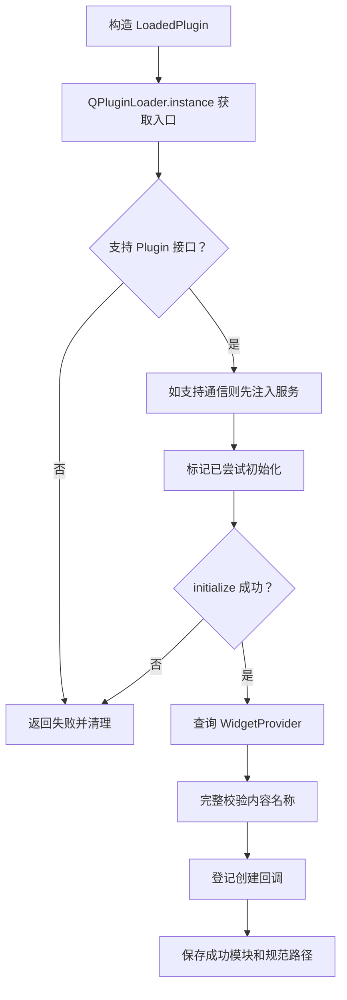

# 05 DLL 插件如何加载

[返回目录](README.md) · [上一章](04-ui-and-factory.md) · [下一章](06-messaging.md)

## 1. DLL 在这里是什么

主程序是可执行程序，插件是运行时被主程序加载的动态库。插件的代码最终与主程序运行在同一个进程里，能创建 Qt 控件、执行函数和修改自己的内存状态。

插件不是独立进程，也不是脚本。DLL 无须被编译进主程序，但必须遵守接口并保持 Qt、编译器、位数和构建配置的兼容性。

## 2. 一个必需接口与两个可选能力

| 接口 | 解决的问题 | 谁实现 |
| --- | --- | --- |
| Plugin | 初始化和关闭业务资源 | 四个插件都实现 |
| WidgetProvider | 声明配置名称并创建 QWidget | Content、Device、Report |
| PluginServicesAware | 接收主程序通信服务 | Content、Device |

主程序通过 qobject_cast 查询能力。DemoPlugin 没有 WidgetProvider 也能正常加载，因为它自行创建独立工具窗口。

拆成可选接口的好处是：已有简单插件不必为了新增通信功能而增加无用方法；需要通信的插件再声明对应能力。

## 3. 扫描过程

[PluginLoader.cpp](C:/Users/35536/Desktop/LearnFramework/LearnFramework/src/runtime/PluginLoader.cpp) 的 loadDirectory 按名称顺序读取目标目录中的文件，通过 QLibrary::isLibrary 过滤候选库，再逐个 loadPlugin。

它只扫描当前目录一层，没有递归查找，也没有插件依赖排序系统。按文件名排序只是当前遍历方式，不应该作为业务依赖契约。

成功文件的规范路径进入 loadedPaths。后续重复扫描同一路径会跳过初始化；失败路径不加入集合，允许以后重试。这是按文件路径去重，不是按插件业务身份去重。

## 4. 加载一个插件的完整步骤



“入口对象”与“业务窗口”不同。instance 获取插件入口，登记回调也不创建面板；面板通常等容器请求时才创建。DemoPlugin 是例外，它在 initialize 内建立工具窗口。

## 5. 为什么服务在 initialize 之前注入

DevicePlugin 初始化时需要注册 2000 和 2001。如果服务在初始化之后才给它，就无法在初始化阶段完整建立通信能力。

每个插件得到独立的 PluginServicesScope，作用域拥有它的注册记录，各作用域共享同一个 PluginMessageHub。这样既能互相通信，也能在一个插件失败时只清理这个插件的回调。

## 6. 为什么先验证所有名称，再统一登记

假设一个插件提供 a、b 两个名称，而 b 已被其他内容占用。如果先注册 a，再发现 b 冲突，工厂就可能留下来自失败插件的半套内容。

当前实现先检查整个名称列表：

- 不能有空白名称。
- 插件内部不能重名。
- 不能与工厂已有名称冲突。

全部通过后才登记。既有名称不被覆盖，冲突插件的初始化资源会随模块清理。

这段实现依赖当前同步流程；登记阶段没有处理每个 registerWidget 的失败结果。在已有校验和单线程条件下预期可成功，不应把它扩展解释为任意并发条件下的事务机制。

## 7. 创建函数为什么捕获 shared_ptr

源码片段：

```cpp
creator = [module, name](QWidget *parent) -> QWidget * {
    QWidget *widget = module->createWidget(name, parent);
    return widget;
};
```

module 按值捕获，增加共享引用。即使加载器先销毁，只要某个工厂副本还保存这个函数，模块记录仍然存在，之后调用不会立刻落到已经关闭的插件上。

模块记录还跟踪返回窗口的 QPointer，并统一调整 parent。最后关闭模块前，残留窗口会先被删除，避免其析构函数引用已经失效的插件资源。

## 8. 四个生命周期函数实际怎么用

Plugin 声明 initialize、start、stop、shutdown，但加载器只直接调用 initialize 与 shutdown。

DemoPlugin 在自己的 initialize 内调用 start 显示窗口，在 shutdown 内调用 stop 隐藏后删除。其他几个插件的 start/stop 只是返回 true。

因此，把必需逻辑只写进 start，期待加载器自动调用，会导致逻辑没有执行。接口里存在方法，不代表当前宿主已经驱动它。

initialize 返回 false 时也会调用 shutdown。插件必须允许清理部分初始化状态；例如 DevicePlugin 注册第二条命令失败时，state 已分配、第一条命令可能已登记，都需要清理。

## 9. “新增插件不重编主程序”的条件

插件使用兼容的公共接口，采用匹配的工具链构建，放在运行目录 plugins 下，并在 UI 使用它提供的名称，就能通过正常重启加载。

这不意味着运行中直接覆盖 DLL 会自动生效。项目没有文件监控、依赖重载或热替换协议；Qt 的 PreventUnloadHint 也被保留，调用 unload 不承诺物理卸载 DLL 映像。

## 10. 建议先读哪个插件

先读 [DemoPlugin.cpp](C:/Users/35536/Desktop/LearnFramework/LearnFramework/examples/DemoPlugin/DemoPlugin.cpp)，只研究 initialize/shutdown 与按钮；再读 [ContentPlugin.cpp](C:/Users/35536/Desktop/LearnFramework/LearnFramework/examples/ContentPlugin/ContentPlugin.cpp)，观察 widgetClasses/createWidget；最后读 DevicePlugin，加入通信和共享状态。

本章自检：主程序到底有没有完全“不知道插件”？它不知道具体业务类，但知道公共接口、名称规则和生命周期契约，这些契约就是双方需要共同遵守的部分。

