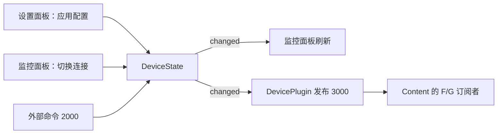

# 07 业务面板与共享状态

[返回目录](README.md) · [上一章](06-messaging.md) · [下一章](08-lifetime.md)

## 1. 先问“数据属于谁”，再看刷新函数

同一个界面有变化，不一定是窗口之间直接调用。这里有三种不同情况：

| 数据 | 谁保存 | 多个面板是否共享 |
| --- | --- | --- |
| FWidget 的 count | 每个 FWidget 对象 | 不共享 |
| GWidget 输入文字 | 每个输入框 | 不共享 |
| 设备名称、间隔、连接状态 | DevicePlugin 拥有的 DeviceState | 该插件创建的设备面板共享 |
| 已提交报表文本 | ReportPlugin 拥有的 ReportState | 预览及后续新建编辑器读取同一份 |
| 编辑器尚未提交的草稿 | 各自 QPlainTextEdit | 不共享 |
| 已收到设备消息的次数 | 各状态标签的动态属性 | 不共享 |

窗口实例独立和业务数据共享完全可以同时成立。

## 2. ContentPlugin：入口负责选择，面板负责交互

[ContentPlugin.cpp](C:/Users/35536/Desktop/LearnFramework/LearnFramework/examples/ContentPlugin/ContentPlugin.cpp) 很短：

- initialize 设置初始化标志。
- widgetClasses 返回 plugin.f 和 plugin.g。
- createWidget 根据名称创建 FWidget 或 GWidget，传入服务和父窗口。
- shutdown 撤销初始化状态。

它不把所有按钮逻辑都写在插件入口中。FWidget/GWidget 分别负责自己的 UI；共同的设备状态订阅抽到 observeDevice，避免复制两套相同代码。

FWidget 的构造顺序是 setupUi → connectSignals → observeDevice。因为 observeDevice 里的同步查询可能立刻执行标签更新，所以标签必须提前创建好。

FWidget 的计数只是 `++count` 并设置按钮文字。GWidget 的文字回显直接连接输入框和标签。先读这两处，是理解 Qt 交互最短的路线。

## 3. DevicePlugin：同一份状态驱动不同操作入口

[DeviceState.h](C:/Users/35536/Desktop/LearnFramework/LearnFramework/examples/DevicePlugin/DeviceState.h) 包含：

```cpp
QString name = QStringLiteral("示例设备");
int refreshInterval = 1000;
bool connected = false;
```

以及 changed 信号。

DevicePlugin 初始化时创建一个 state；每次创建监控或设置面板，都传入这个指针。因此不是“设置窗口找到监控窗口并修改它”，而是“设置窗口修改共享状态，监控窗口监听状态变化”。



将来换一个设置面板，只要还遵守状态修改与通知约定，监控面板可以继续工作。

## 4. 设备设置为什么要有“应用”按钮

DeviceSettingsWidget 创建时调用 loadSettings，把共享状态复制进输入控件。输入控件里的值是草稿，编辑时不会立即写回 state。

点击应用时：

1. 取得名称并 trimmed。
2. 名称为空则显示提示，不提交。
3. 写入 name 与 refreshInterval。
4. 发出 changed。
5. 显示“仅在本次运行中保留”。

间隔输入框范围是 100～60000 ms。这里的范围来自控件，不能推导为整个系统有完整的设备参数校验层。

设置面板没有订阅 changed 来重填草稿，这是有意保留未提交编辑。如果创建两个设置面板，其中一个应用配置，另一个输入框不会自动被覆盖。

## 5. 监控为何能同时反映本地按钮和跨插件命令

本地 toggleConnection 与跨插件 handleSetConnection 最终都写入同一个 state，再发出 changed。监控的 refreshState 统一读取 name、connected、refreshInterval 更新标签。

这样不需要为“来自本地”和“来自外部”的状态分别写两套显示逻辑。

不过 DeviceState 字段是公开的。如果将来新增代码只赋值、不 emit changed，其他面板不会自动刷新。当前设计依赖调用者遵守约定；把写入收敛到 setter 是一种可考虑的改进，当前源码尚未这样实现。

## 6. ReportPlugin：草稿与已提交数据分开

[ReportPlugin.cpp](C:/Users/35536/Desktop/LearnFramework/LearnFramework/examples/ReportPlugin/ReportPlugin.cpp) 在同一个文件中定义预览和编辑窗口。

编辑器创建时把 state->text 复制到文本框。之后敲字只修改本窗口草稿；点击“更新预览”时才：

```cpp
state->text = editor->toPlainText();
emit state->changed();
```

预览窗口监听 changed，重新设置只读文本框的内容。若同时有两个预览，都更新；若有两个编辑器，另一个编辑器的草稿保持原样。

新的编辑器读取最近已提交的文本。销毁旧编辑器再创建它，会丢失未提交草稿，却能读取插件还保留着的已提交内容。

这里没有数据库、文件保存、PDF 导出或历史版本。报表面板只是共享文本状态的演示。

## 7. 切换内容后，什么保留、什么重置

| 操作 | 结果 |
| --- | --- |
| FWidget 切到另一类型再切回 | 新 FWidget，计数从 0 开始 |
| 对现有 FWidget 再 setContentClass("plugin.f") | 同一个对象，计数保留 |
| 设备监控切走再切回 | 新窗口读取仍存活的 DeviceState |
| 报表编辑器切走再切回 | 未提交草稿丢失，读取已提交文本 |
| 退出整个程序再启动 | 业务状态按初始化代码重新建立 |

这是判断状态应该放哪一层的实用方法：如果希望换窗口后仍存在，就不能只把它放在旧窗口成员里。

## 8. 本章练习

在设备设置里输入一个新名字，先不点应用，观察监控和 Content 状态标签；随后点应用再观察。预期前者保持原状，后者同步更新。

再在报表编辑器输入文字，比较点击“更新预览”前后的差别。能够解释这两个过程，就理解了“草稿 → 提交 → 通知 → 展示”的数据流。

这个项目可借用“状态与显示分离”的思路理解，但没有完整实现标准 MVC/MVVM 框架，不必强行给每个类套模式名称。

